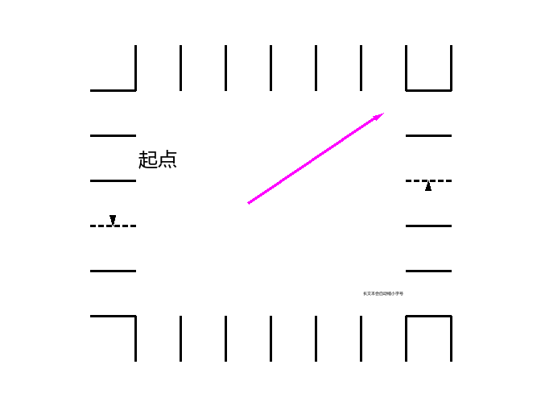
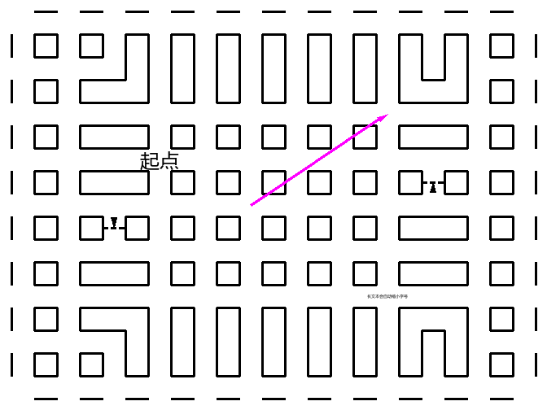
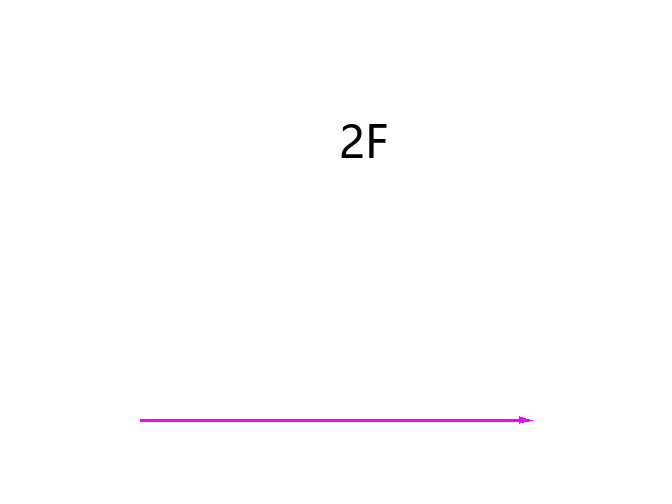
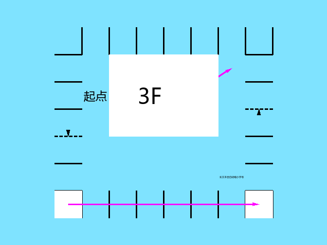

# 迷宫地图编辑器 · Maze Map Designer

一个用 Python + Tkinter + Pillow 写的**多层平面迷宫地图编辑器**。只做「编辑与显示」，不做游玩、不做自动生成、不做寻路。



## 0. 关于本项目

* 本软件完全由 **DeepSeek V4.1 Flash** 编写。
* 本软件最初被设计用于绘制 **LinkCraft** 的迷宫，为录制 LinkCraft 迷宫攻略视频提供支持。
* 由于 LinkCraft 的规定，本仓库不会提供 LinkCraft 的迷宫地图文件，录制完成的视频也不会公开发布。

本仓库以 **MIT 许可证**发布，全文见 [LICENSE](LICENSE)。
许可证只覆盖本仓库的源代码与文档；LinkCraft 的迷宫地图与视频不在其中。

开发过程按轮记录在 [CHANGELOG.md](CHANGELOG.md)，还没做的事情在 [TODO.md](TODO.md)。

## 1. 需求对照

| 需求 | 实现 |
| --- | --- |
| 平面迷宫，正方形单元，薄墙 | 墙位于两个相邻单元的交界处，由**两个方向**独立描述 |
| 多层 | 楼层栈，可增删、上下移动、逐层编辑 |
| 设置迷宫大小 | 工具栏「宽 / 高 / 应用尺寸」；层数可设 |
| 保存并读取文件 | JSON 文件（`Maze.save` / `Maze.load`，工具栏「打开 / 保存 / 另存为」），默认文件夹 `mazes/` |
| 导出 PNG | 一键导出到 `exported_png/<迷宫名>.png`，**真实透明底**，已存在直接覆盖、不弹窗；见 3.9 |
| 鼠标编辑 | 左键绘制、右键擦除/循环、中键拖动平移、Ctrl+滚轮缩放；另有拖动连续涂、整片填充 |
| 连通状况三种 | ① 连通且不绘制 ② 不连通 → 实线 ③ 单向连通 → 虚线 + 箭头 |
| 单元种类四种 | ① 空气（透明）② 地面（地面色底）③ 单向传送门（地面色底 + 指向目的地中心的箭头，仅同层）④ 文本（地面色底 + 居中自适应文本） |
| 每层的物件颜色 / 地面颜色 / 传送门颜色 / 墙宽 | 顶栏**第三行**的文本框，回车生效；**以楼层为单位**存进迷宫文件；新建楼层的默认值是 黑 / 白 / `#FF00FF` / 3 |
| 每层的**面积占比**（0~100 的整数） | 同一个「当前楼层外观」行里的文本框，默认 100；按楼层存进迷宫文件。它把单元里的**地板与墙一起缩小**，规则见 3.6 |
| 传送门箭头颜色单独设置 | 每层一个，默认 `#FF00FF` |
| 颜色的**不透明度**（两位 16 进制，`FF` 全显示、`00` 不显示） | 三种颜色都写成 `#RRGGBBAA`，后两位不透明度随颜色一起按楼层存进迷宫文件；见 3.5 |
| 绘制顺序自下而上 | 按楼层栈从底到顶合成，高层按自己的不透明度盖在低层上 |
| **仅显示当前层** | 顶栏第三行末尾的复选框，默认不勾选；勾上后只绘制当前层，其他层完全不画 |

## 2. 运行

需要 Python 3.9+（开发环境 3.11.3）。依赖只有 Pillow：

```powershell
pip install pillow
python app.py                      # 打开示例迷宫开始编辑
python app.py mazes\lcVII.json     # 打开已有迷宫文件
```

`config.json` 不存在时会自动写入默认配置。**迷宫文件都放在 `mazes/`，导出的 PNG 都放在
`exported_png/`**：打开 / 另存为的对话框默认停在这两个文件夹（没有就自动建），
这两个文件夹也写进了 `.gitignore`，不会污染仓库。详见 3.9。

### 生成 preview 图片（不开窗口）

```powershell
# 示例迷宫，1 层为当前层，只画这一层（透明底）
python cli.py --sample --out exported_png/preview_f1.png --cell-size 56 --active 0 --only-active

# 只画墙和单向箭头（不画地板 / 文本 / 传送门），用于核对墙的位置
python cli.py --sample --out exported_png/preview_walls_f1.png --cell-size 56 --active 0 --walls-only

# 临时把这一层的面积占比改成 50 %（只影响本次渲染，不写回文件）
python cli.py --sample --out exported_png/preview_f1_area50.png --cell-size 56 --active 0 --only-active --area-ratio 50

# 颜色可以带不透明度：这里是 50 % 的天蓝色地板（见 3.7）
python cli.py --sample --out exported_png/preview_f_alpha.png --cell-size 56 --active 0 --floor-color "#00C8FF80"

# 渲染自己的迷宫文件，并另存一份 JSON
python cli.py mazes/lcVII.json --out exported_png/lcVII.png --cell-size 40 --active 1 --save-json mazes/copy.json
```

常用参数：`--out` 输出 PNG（默认 `exported_png/preview.png`，保留真实透明底）、
`--active` 当前编辑楼层的**栈内下标**（0 = 最底层）、
`--cell-size` 单元格像素、`--walls-only` 只画墙、`--only-active` 只画当前层（不合成其他层）、
`--object-color` / `--floor-color` / `--portal-color` / `--wall-width` / `--area-ratio`
临时覆盖当前层的这几项外观（颜色写 `#RRGGBB` 或 `#RRGGBBAA`）、
`--config` 指定配置文件、`--save-json` 顺手另存迷宫。

### 测试

```powershell
python tests\test_maze.py    # 数据模型 / 配置 / 渲染的像素级检查（58 项）
python tests\test_gui.py     # GUI 冒烟测试：模拟鼠标编辑、存读、缩放、导出
```

## 3. 怎么编辑

### 3.1 界面分区

* **第一行**：文件（新建 / 打开 / 保存 / 另存为）、迷宫宽高（改完按「应用尺寸」）、
  层数（只读显示）、**在当前楼层上插入楼层** / **在当前楼层下插入楼层** / **删除当前层**。
* **第二行**：工具选择、单元格种类、墙状态、楼层导航（▲ 上一层 / ▼ 下一层 / 最底层 / 最高层 /
  将当前楼层上移 / 将当前楼层下移）、单元大小、重载配置、导出 PNG（直接写
  `exported_png/<迷宫名>.png`，不弹窗，见 3.9）。
  「单元格种类」和「墙状态」两个下拉框只有当前工具那个能用：
  选「单元内容」时「墙状态」是灰的，选「墙」时「单元格种类」是灰的（程序刚启动时也一样）。
* **第三行（当前楼层外观）**：**物件颜色**、**地面颜色**、**传送门颜色**、**墙宽**、**面积占比**五个文本框，
  末尾还有 **填充** 与 **仅显示当前层** 两个复选框。
  改完按 **回车**（或点开别处）立即生效并重绘。这五个值是**按楼层**保存的：
  切到别的楼层会显示那一层自己的值，新建迷宫 / 新建楼层则用默认值
  （物件黑 `#000000FF`、地面白 `#FFFFFFFF`、传送门 `#FF00FFFF`、墙宽 3、面积占比 100）。
  颜色写成 `#RRGGBBAA`：**前六位是颜色，最后两位是不透明度**（`FF` 完全显示、`00` 完全不显示），
  不透明度随颜色一起按楼层保存；也接受 `#RRGGBB`、`#RGB` 或省略 `#`（这时算完全不透明）。
  墙宽限 1~64，面积占比限 0~100；写错了不会生效，输入框会回显当前真正生效的值。
* **画布**：合成后的迷宫（没有额外的边框或网格，画面就是迷宫本身）。
* **状态栏**：当前楼层、这一层的外观（颜色含不透明度、墙宽、面积占比）、是否「仅显示当前层」、
  鼠标所在单元（坐标 / 种类 / 四向通路）、当前工具的提示、未保存标记 `*`。

### 3.2 两种工具 与 填充（「工具」下拉框 + 「填充」复选框）

**① 单元内容**（默认）
* 先在「单元格种类」里选：空气 / 地面 / 单向传送门 / 文本。
* **左键**：把该单元涂成所选种类。**空气 / 地面支持按住左键拖动连续涂**（拖过的路径会补齐，
  鼠标移动太快也不会漏格）。补齐的是**从上一个鼠标事件到当前位置的直线**（Bresenham，
  并且每步都走四邻格，不跨角），所以涂出来的痕迹和鼠标真正划过的路线一致。
* **右键**：把该单元擦成空气。
* **单向传送门**：两次点击 —— 先点**起点**单元格（此时显示为一个圆环，表示还没定目的地），
  再点**目的地**单元格，立刻画出从起点中心指向目的地中心的箭头。点同一个格子或按 **Esc** 取消。
* **文本**：点击后弹窗输入文本；文本在单元格内居中，字号按文本长度自适应。

**② 墙**
* 先在「墙」下拉框里选：连通 / 墙 / 单向板
  （即「连通且不绘制」/「不连通，画实线」/「单向连通，画虚线+箭头」）。
* 鼠标要**点在两个单元的交界处附近**（离边界 28% 格宽以内），点在格子中央不会改墙。
  若这一层的面积占比小于 100，墙画在内缩线上，判定范围会跟着往里移
  （不会超过 45% 格宽，格子中央始终留给「单元内容」笔刷）。
* **左键**：设为所选状态，**支持按住左键沿边界拖动连续设置**（跨格时中间经过的边也会补上）。
  选「单向板」时默认方向是「左/上单元 → 右/下单元」；按住 **Shift+左键** 得到反方向。
* **右键**：在 连通 → 墙 → 单向板 → 连通 之间循环，方便快速试。
* 判断点击位置用的是「离最近的那条边更近」：靠近上下边界就改上下方向的墙，靠近左右边界就改左右方向的墙。
* **一次拖拽只放一个方向的墙**：按下时碰到的是左右边界，这次拖拽就只设左右方向的墙
  （竖线），拖到上下边界附近也不会改成横向；反之亦然。而且整条拖拽都画在按下时选中的
  **那一条格线**上——拖着走过多少格，这条线上就补多少段，中间不会漏。

**填充**（工具栏右端的「填充」复选框，只对**地面 / 空气**生效）

勾上以后「单元内容」笔刷变成油漆桶，**一次点击改一整片，并且禁用拖动**：

| 点击到的单元 | 结果 |
| --- | --- |
| 就是要涂的那种（选地面时点到地面 / 选空气时点到空气） | 什么都不做 |
| 单向传送门 或 文本 | 只改这一个单元（不扩散） |
| 另一种散装单元（选地面时点到空气 / 选空气时点到地面） | 把**与它相连的同类单元全部改掉** |

「相连」只算**四邻格**（斜着不算），而且**被墙（不连通）挡住的地方不会越过去**，
所以先用墙围出一个房间，再进去点一下，就只填这个房间；单向板不算墙，照样连通。
只改**当前楼层**。完成后状态栏显示一共改了多少格。
勾着「填充」时若选中传送门 / 文本，笔刷仍按单格点击处理。

### 3.3 楼层编辑

只有四种操作，够用且不会有歧义：

| 按钮 | 作用 |
| --- | --- |
| 在当前楼层上插入楼层 | 在当前层**上面**插入一个空层，新层成为当前层 |
| 在当前楼层下插入楼层 | 在当前层**下面**插入一个空层，新层成为当前层 |
| 将当前楼层上移 | 与上面一层**交换**，当前层跟着走 |
| 将当前楼层下移 | 与下面一层**交换**，当前层跟着走 |
| 删除当前层 | 删除当前层（只剩一层时不允许） |

楼层号是**栈内位置的函数**：栈底第 1 层就是 `1` 层，往上依次 `2, 3, 4, ...`（只考虑地上层，
没有地下层，也不存在 0 层）。所以在中间插入一层会让它上面的楼层号顺延一位，颜色也随之变化；
「上移 / 下移」交换内容，被移动的那一层会按新位置取到新的楼层号和颜色。每次操作后画布**立即重绘**。

「▲ 上一层 / ▼ 下一层」是**切换正在编辑的楼层**：上一层 = 楼层号 +1（往高处走），
下一层 = 楼层号 -1（往低处走）。

### 3.4 键盘 / 鼠标快捷操作

| 操作 | 作用 |
| --- | --- |
| 按住左键拖动 | 用当前笔刷连续涂（单元内容：空气/地面；墙：沿边界连续设墙；勾着「填充」时不拖动） |
| 中键拖动 | 平移画布 |
| 方向键 | 平移画布 |
| 滚轮 | 上下滚动 |
| Ctrl+滚轮 或 `Z` / `X` | 缩小 / 放大单元格 |
| `PageUp` / `PageDown` | 上一层 / 下一层 |
| `Home` / `End` | 最底层 / 最高层 |
| `Delete` | 清空当前楼层的所有内容与墙（会确认） |
| `Ctrl+S` / `Ctrl+Shift+S` / `Ctrl+O` / `Ctrl+N` | 保存 / 另存为 / 打开 / 新建 |
| `Esc` | 取消传送门待定起点 |

「单元大小」输入框里键入数字后按 **回车**（或点开别处）立即生效并重绘；
在该输入框里按 **↑ / ↓** 也可以直接微调单元大小。

### 3.5 楼层与颜色规则

* 楼层号：`1, 2, 3, ...`，栈底是 1 层。只考虑地上层，没有地下层。
* **颜色与墙宽按楼层保存**：每一层各有一套「物件颜色 / 地面颜色 / 传送门颜色 / 墙宽 / 面积占比」，
  在顶栏第三行的文本框里改，写进迷宫文件的 `layers[i]` 里。
  颜色与楼层号无关，也没有全局色组。
  * **物件颜色**：这一层的墙、文本、单向箭头。
  * **地面颜色**：这一层所有单元（普通地面 / 传送门 / 文本）的底色。
  * **传送门颜色**：这一层传送门箭头（以及「还没选目的地」时的那个圆环）。
  * **墙宽**：这一层实线与虚线的线宽（像素）。
  * **面积占比**：这一层地板占单元的比例，0~100，默认 100（见 3.6）。
* **不透明度写在颜色里**：三种颜色都是 `#RRGGBBAA`，后两位是不透明度，
  `FF` 完全显示、`00` 完全不显示，随颜色一起按楼层保存。渲染时每个元素按**自己颜色的不透明度**画，
  所以「地板半透明、墙仍然实心」是很自然的写法。同一层内部按「地板 → 墙 / 单向板 → 文本 / 传送门」
  的顺序合成，因此半透明的墙是叠在这一层自己地板上，而不是叠在下层上。
* **合成顺序**：从栈底到栈顶依次 alpha 合成，所以高层按自己的不透明度盖在低层上，
  低层能透出多少完全由上层颜色的不透明度决定。
* **透明度只由颜色决定**：没有「按楼层距离衰减」（差 1 层 50 %、差 2 层 75 %）这种规则。
  想让别的楼层淡下去，就改那一层颜色的后两位，或者直接勾上 **仅显示当前层**。
* **仅显示当前层**（顶栏第三行末尾的复选框，默认不勾选）：勾上后只绘制当前层，
  其他层完全不参与合成；它是一个**视图开关**，不会写进迷宫文件，也不会改变任何楼层的数据。
  导出 PNG 跟着当前视图走：勾上时导出的图也只有当前层。

### 3.6 面积占比（每层一个 0~100 的整数）

设单元边长 `S`（像素）、面积占比为 `r`，令

```
inner = round(S × r / 100)        # 至少 1 像素：r = 0 时也还留一个中心点
inset = (S − inner) / 2
四点  = (inset, inset) (inset, S−inset) (S−inset, inset) (S−inset, S−inset)
```

（例：`S = 100、r = 50` → `inset = 25、inner = 50`，四点就是 `25,25 / 25,75 / 75,25 / 75,75`。）

过这四点画 4 条**内缩线**（`x=inset`、`x=S−inset`、`y=inset`、`y=S−inset`），把单元切成九块：

```
┌────┬─────┬────┐
│ 角 │ 边  │ 角 │   角块：永远是空的（透明）
├────┼─────┼────┤   边中块：邻居有地板**并且**这条边不是实墙时才画 → 地板伸出去的「臂」
│ 边 │ 中心│ 边 │   中心块：一定画
├────┼─────┼────┤
│ 角 │ 边  │ 角 │
└────┴─────┴────┘
```

* **地板** = 中心块 + 朝「**有地板且这条边不是实墙**」的邻居伸出的边中块。邻居是空气（或根本不存在，
  例如迷宫边界）不伸臂；这条边是实墙时两边都不伸臂。**单向板算连通**，所以单向口两侧的地板仍然相接。
* **墙 / 单向板**只占该边的**中段**（长度 `inner`）：
  * 实墙 → 画在**各单元自己的内缩线**上（也就是各自地板的边缘）。因此相邻两格都封闭时是
    **两条平行的墙**，两条墙中间是**空的**（没有臂，也就没有地板）。
  * 单向板 → 两侧的地板都伸到**共同边界**，所以虚线 + 箭头就画在**共同边界**上
    （箭头指向可通行方向，长度按 `inner` 收缩以保证放得下）。
  * 连通 → 什么都不画，这里正是地板穿过的口子。
* 每条内缩线两端的**外段**在**垂直方向的臂存在**（即同一条件）时画出来——它们勾勒的是空着的角块。
  这正是「四边都连通，却依然画出 8 段墙」的来源：四个单元交汇处会出现一个空的方形缺口，
  由周围 4 个单元各出 2 段线围成；反过来，某条边的臂不存在时，那两个外段也跟着消失。
* **空气单元什么都不画**（既没有地板也没有墙）。所以两边都是空气的那条边，即使设成墙或单向板，
  画面上也完全看不见。
* `r = 100` 时 `inset = 0`、外段长度为 0，退化成「地板铺满整格、墙正好压在共同边界上」的样子；
  文件里没有这个字段时也按 100 处理。
* 文本仍按**整个单元**的大小自适应字号（不缩到中心块），传送门箭头仍从单元中心指向目的地单元中心。

`r = 50` 下三种边的样子（`python tests\make_state_preview.py` 生成，透明底 = 空白区域）：


从左到右：**实墙**（两条平行墙，中间空）→ **单向板**（地板相接，虚线+箭头压在共同边界上，
箭头往回伸进能通过的那一格）→ **连通**（什么都不画，地板连成一片）。

1 层与 2 层在 50 % 下的样子（只画当前层，透明底 = 空白区域）：




### 3.7 颜色的不透明度

1 层的地板色临时改成 50 % 不透明的天蓝色后（
`python cli.py --sample --out exported_png/preview_f_alpha.png --cell-size 56 --active 0 --floor-color "#00C8FF80"`）：
这层地板下面透出来的是**真正的透明底**（看图时就是页面自己的底色），而这一层的墙、文本、
单向箭头仍然是实心的黑，2、3 层的白色地板照旧盖在它上面——每个元素都按**自己颜色**的后两位画：



### 3.8 大迷宫的性能

画布上的画面被切成一块块「图块（tile）」，每块 8×8 个单元（80×80 的迷宫就是 10×10 = 100 块，
30×27 的迷宫 4×4 = 16 块），每块一个 `PhotoImage` + 一个 canvas item：

* **编辑一次只重画被改动的那 1~4 块**（`app.refresh_dirty()`），
  所以延迟只跟改动量有关，与迷宫多大无关；
* 换楼层在没勾「仅显示当前层」时不需要重画（合成结果与当前层无关）；
* 打开 / 新建 / 缩放 / 改颜色或面积占比 / 增删楼层这类整体变化才走整幅重绘
  （`app.refresh()`：整幅渲染一次，再切成图块）；
* 两种路径都先在 PIL 里把画面压到画布底色上再交给 Tk
  （`MazeEditorApp._flatten()`，透明单元看起来仍是画布底色那个灰）：Tk photo 没有可用的
  alpha，把**同时含不透明与透明像素**的图交给它要逐像素混合，实测约 0.3~1.7 µs/像素且随面积
  超线性增长，而同样大小的不透明图只要 ~6 ns/像素。

用 `renderer.render_region()` 只画一个矩形，像素结果与整幅渲染完全相同
（测试 `test_region_render_matches_the_full_picture` 逐像素比对；墙宽 1/3/8、
面积占比 100/50/0、半透明配色、仅当前层、只画墙都覆盖）。

一次编辑的总延迟（同一台机器）：

| 迷宫 | 单元边长 | 编辑一次 |
| --- | --- | --- |
| 20×20×2 | 40px | **9.5 ms** |
| 30×27×4 | 40px | **10.5 ms** |
| 30×27×4 | 50px | **17.3 ms** |
| 80×80×4（半透明配色） | 25px | **13.2 ms** |
| 80×80×4（半透明配色） | 50px | **19.8 ms** |

整幅重绘只在开局 / 缩放 / 改外观时发生（80×80×4 在 50px 下约 2.3 s，30×27×4 约 0.16 s）。
这些数字是怎么来的（以及还能怎么再快）见 [CHANGELOG.md](CHANGELOG.md) 与 [TODO.md](TODO.md)。

### 3.9 保存与导出（文件位置）

* **迷宫 JSON**：打开 / 另存为的对话框默认停在项目下的 `mazes/`，文件放哪儿都行。
* **导出 PNG**：点「导出 PNG」**不弹窗、不问文件名**，直接写
  `exported_png/<当前迷宫文件名>.png` —— 正在编辑 `mazes/lcVII.json` 就导出成
  `exported_png/lcVII.png`；文件已存在**直接覆盖**。还没保存过的新迷宫
  （以及 `--sample` 示例迷宫）导出成 `exported_png/maze.png`。
  导出完成后状态栏会显示导出到哪儿（Windows 上是 `已导出 exported_png\lcVII.png`）。
* 导出的 PNG 与画布上看到的一致（跟随当前楼层与「仅显示当前层」），但**空气单元是真正的
  透明像素**，透明处露出的是看图程序自己的底色。命令行 `cli.py --out` 同理（默认也写进
  `exported_png/`）。
* `mazes/` 与 `exported_png/` 都在 `.gitignore` 里；只有 README 引用的
  `exported_png/preview_f*.png` 示意图仍然入库。

## 4. 文件格式

```jsonc
{
  "format": "maze-map-designer",
  "version": 1,
  "width": 12,          // 单元列数
  "height": 9,          // 单元行数
  "active": 0,          // 上次编辑的栈内下标
  "layers": [
    {
      "name": "",
      "object_color": "#000000FF",  // 这一层的物件颜色（墙 / 文本 / 箭头），末两位是不透明度
      "floor_color": "#FFFFFFFF",   // 这一层的地板底色，末两位是不透明度
      "portal_color": "#FF00FFFF",  // 这一层的传送门箭头颜色，末两位是不透明度
      "wall_width": 3,             // 这一层的墙宽（像素）
      "area_ratio": 100,           // 这一层的面积占比 0~100（见 3.6）
      "cells": [ [x, y, {"kind": "text", "text": "起点"}] ],   // 只存非空气单元
      "edges": [ [cx, cy, axis, a_to_b, b_to_a] ]              // 只存非“双向连通”的边
    }
  ]
}
```

* `axis`：`0` 表示这条边分隔 `(cx, cy)` 与 `(cx+1, cy)`（左右相邻，画**竖线**）；
  `1` 表示分隔 `(cx, cy)` 与 `(cx, cy+1)`（上下相邻，画**横线**）。
* `active` 是栈内下标，楼层号 = 下标 + 1。旧文件里可能存在的 `basement` / `lowest_floor`
  字段会被忽略。
* `object_color` / `floor_color` / `portal_color` / `wall_width` / `area_ratio` 缺失或写坏时，
  该层用默认值（黑 / 白 / `#FF00FF` / 3 / 100），文件仍然能打开。
* 三种颜色都是 `#RRGGBBAA`（末两位是不透明度）。只写了 `#RRGGBB` 或 `#RGB` 的旧文件照样能读，
  读进来会补成 `FF`（完全不透明）。
* `a_to_b` / `b_to_a`：两个方向是否可通行。`[1,1]` = 连通（不画）、`[0,0]` = 实线、
  `[1,0]` / `[0,1]` = 单向（虚线 + 箭头，箭头指向可通行方向）。
* 传送门只存同层目的地：`{"kind": "portal", "portal": [x, y]}`。

## 5. 配置文件 `config.json`

```jsonc
{
  "wall": { "dash": [6, 4], "arrow_length": 0.22, "arrow_width": 3 },
  "cell_size": 40,
  "text": { "font_family": "Microsoft YaHei", "min_size": 5, "fill_ratio": 0.88 }
}
```

* `wall` 里只有三个**与墙的外观有关、与楼层无关**的参数：虚线节拍
  （`[实线长, 空白长]`，单位像素）、箭头长度（占格宽比例）、箭头宽度。
* `cell_size`：默认单元格像素；`text`：文本字体、最小字号、文本占格比例（自适应字号的上限）。
* 每层的物件颜色 / 地面颜色 / 传送门颜色 / 墙宽 / 面积占比**不在**这个文件里，
  而是随迷宫文件保存（见上一节）。旧配置文件里的 `object_color_group` / `floor_color_group` /
  `portal_color` / `color_group` / `wall.width` 会被忽略，不影响已有迷宫的外观。
* 「仅显示当前层」「填充」也不在这里 —— 它们只是当前窗口的开关，既不写配置文件也不写迷宫文件。
* 改完配置后在界面点「重载配置」即可生效，不必重启。

## 6. 源码结构

| 文件 | 作用 |
| --- | --- |
| `app.py` | Tkinter 界面：工具栏（含第三行的楼层外观、填充与「仅显示当前层」）、图块画布、鼠标/键盘编辑（拖拽按鼠标真实轨迹补齐、墙笔刷锁定方向、填充整片）、文件对话框、上传前把画面压平（见 3.8）、导出 PNG 直接写 `exported_png/`（见 3.9） |
| `maze.py` | 数据模型：`Maze`（楼层栈）、`Layer`（单元 + 有向边 + 外观 + 面积占比 + 连通区域）、`CellData`、存读 |
| `renderer.py` | Pillow 渲染：按层按颜色不透明度合成、面积占比的九宫格几何、实线/虚线+箭头、传送门箭头、文本自适应字号，以及只画一个矩形区域的增量渲染（见 3.8） |
| `config.py` | 全局配置读取与默认值（墙的虚线/箭头、单元大小、文本字体）及颜色字符串解析 |
| `cli.py` | 命令行渲染 / 转换工具（输出透明底 PNG，默认写到 `exported_png/`） |
| `tests/test_maze.py` | 数据模型、配置、渲染的像素级断言（含「局部渲染 == 整幅渲染」的逐像素比对） |
| `tests/test_gui.py` | GUI 冒烟测试（模拟鼠标事件、检查控件与第三行文本框、读回画布像素与整幅渲染比对） |
| `CHANGELOG.md` | 每一轮的改动记录（要什么 / 怎么改 / 怎么验证） |
| `TODO.md` | 还没做的事情 |
| `LICENSE` | MIT 许可证全文 |

迷宫文件放 `mazes/`，导出的 PNG 放 `exported_png/`（见 3.9，两者都不入库）。

## 7. 版本与开发记录

当前是第 10 轮迭代后的状态。每一轮的来龙去脉在 [CHANGELOG.md](CHANGELOG.md)，
剩余待办与已知限制在 [TODO.md](TODO.md)。
