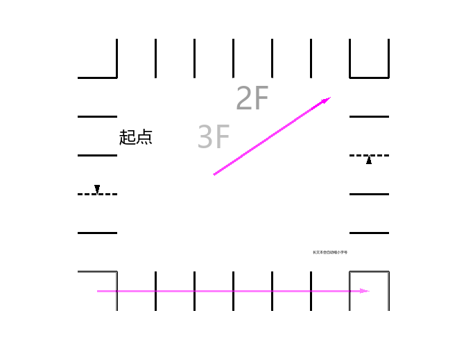
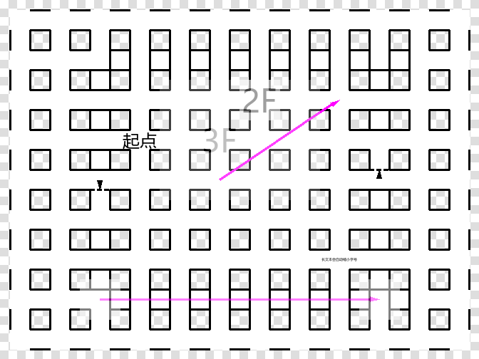
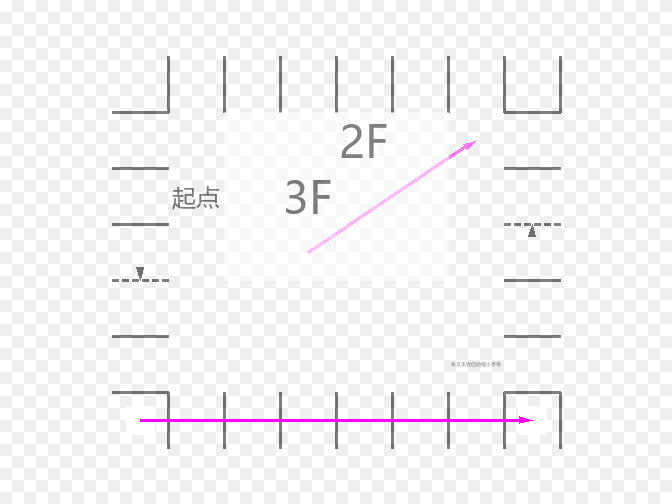

# 迷宫地图编辑器 · Maze Map Designer

一个用 Python + Tkinter + Pillow 写的**多层平面迷宫地图编辑器**。只做「编辑与显示」，不做游玩、不做自动生成、不做寻路。



## 1. 需求对照

| 需求 | 实现 |
| --- | --- |
| 平面迷宫，正方形单元，薄墙 | 墙位于两个相邻单元的交界处，由**两个方向**独立描述 |
| 多层 | 楼层栈，可增删、上下移动、逐层编辑 |
| 设置迷宫大小 | 工具栏「宽 / 高 / 应用尺寸」；层数可设 |
| 保存并读取文件 | JSON 文件（`Maze.save` / `Maze.load`，工具栏「打开 / 保存 / 另存为」） |
| 鼠标编辑 | 左键绘制、右键擦除/循环、中键拖动平移、Ctrl+滚轮缩放 |
| 连通状况三种 | ① 连通且不绘制 ② 不连通 → 实线 ③ 单向连通 → 虚线 + 箭头 |
| 单元种类四种 | ① 空气（透明）② 地面（地面色底）③ 单向传送门（地面色底 + 指向目的地中心的箭头，仅同层）④ 文本（地面色底 + 居中自适应文本） |
| 每层的物件颜色 / 地面颜色 / 传送门颜色 / 墙宽 | 顶栏**第三行**的文本框，回车生效；**以楼层为单位**存进迷宫文件；新建楼层的默认值是 黑 / 白 / `#FF00FF` / 3 |
| 每层的**面积占比**（0~100 的整数） | 同一个「当前楼层外观」行里的文本框，默认 100；按楼层存进迷宫文件。它把单元里的**地板与墙一起缩小**，规则见 3.6 |
| 传送门箭头颜色单独设置 | 每层一个，默认 `#FF00FF` |
| 透明度按距离衰减 | 当前层 0%，上下 1 层 50%，2 层 75%，3 层 87.5%…（`0.5^距离`） |
| 绘制顺序自下而上 | 按楼层栈从底到顶合成，高层自然覆盖低层 |

## 2. 运行

需要 Python 3.9+（开发环境 3.11.3）。依赖只有 Pillow：

```powershell
pip install pillow
python app.py                 # 打开示例迷宫开始编辑
python app.py my_maze.json    # 打开已有迷宫文件
```

`config.json` 不存在时会自动写入默认配置。

### 生成 preview 图片（不开窗口）

```powershell
# 示例迷宫，1 层为当前层，棋盘底显示透明区域
python cli.py --sample --out preview_f1.png --checkerboard --cell-size 56 --active 0

# 只画墙和单向箭头（不画地板 / 文本 / 传送门），用于核对墙的位置
python cli.py --sample --out preview_walls_f1.png --cell-size 56 --active 0 --walls-only

# 临时把这一层的面积占比改成 50 %（只影响本次渲染，不写回文件）
python cli.py --sample --out preview_f1_area50.png --checkerboard --cell-size 56 --active 0 --area-ratio 50

# 渲染自己的迷宫文件，并另存一份 JSON
python cli.py my_maze.json --out my.png --cell-size 40 --active 1 --save-json copy.json
```

常用参数：`--out` 输出 PNG、`--active` 当前编辑楼层的**栈内下标**（0 = 最底层）、
`--cell-size` 单元格像素、`--checkerboard` 棋盘底、`--walls-only` 只画墙、
`--object-color` / `--floor-color` / `--portal-color` / `--wall-width` / `--area-ratio`
临时覆盖当前层的这几项外观、`--config` 指定配置文件、`--save-json` 顺手另存迷宫。

### 测试

```powershell
python tests\test_maze.py    # 数据模型 / 配置 / 渲染的像素级检查（51 项）
python tests\test_gui.py     # GUI 冒烟测试：模拟鼠标编辑、存读、缩放
```

## 3. 怎么编辑

### 3.1 界面分区

* **第一行**：文件（新建 / 打开 / 保存 / 另存为）、迷宫宽高（改完按「应用尺寸」）、
  层数（只读显示）、**在当前楼层上插入楼层** / **在当前楼层下插入楼层** / **删除当前层**。
* **第二行**：工具选择、单元格种类、墙状态、楼层导航（▲ 上一层 / ▼ 下一层 / 最底层 / 最高层 /
  将当前楼层上移 / 将当前楼层下移）、单元大小、重载配置、导出 PNG。
* **第三行（当前楼层外观）**：**物件颜色**、**地面颜色**、**传送门颜色**、**墙宽**、**面积占比**五个文本框。
  改完按 **回车**（或点开别处）立即生效并重绘。这五个值是**按楼层**保存的：
  切到别的楼层会显示那一层自己的值，新建迷宫 / 新建楼层则用默认值
  （物件黑 `#000000`、地面白 `#FFFFFF`、传送门 `#FF00FF`、墙宽 3、面积占比 100）。
  颜色接受 `#RRGGBB`、`#RGB` 或省略 `#`；墙宽限 1~64，面积占比限 0~100；
  写错了不会生效，输入框会回显当前真正生效的值。
* **画布**：合成后的迷宫（没有额外的边框或网格，画面就是迷宫本身）。
* **状态栏**：当前楼层、这一层的外观（含面积占比）、其他层透明百分比、鼠标所在单元（坐标 / 种类 / 四向通路）、当前工具的提示、未保存标记 `*`。

### 3.2 两种工具（工具栏「工具」下拉框）

**① 单元内容**（默认）
* 先在「单元格种类」里选：空气 / 地面 / 单向传送门 / 文本。
* **左键**：把该单元涂成所选种类。**空气 / 地面支持按住左键拖动连续涂**（拖过的路径会补齐，
  鼠标移动太快也不会漏格）。
* **右键**：把该单元擦成空气。
* **单向传送门**：两次点击 —— 先点**起点**单元格（此时显示为一个圆环，表示还没定目的地），
  再点**目的地**单元格，立刻画出从起点中心指向目的地中心的箭头。点同一个格子或按 **Esc** 取消。
* **文本**：点击后弹窗输入文本；文本在单元格内居中，字号按文本长度自适应。

**② 墙**
* 先在「墙」下拉框里选：连通 / 墙 / 单向板
  （即「连通且不绘制」/「不连通，画实线」/「单向连通，画虚线+箭头」）。
* 鼠标要**点在两个单元的交界处附近**（离边界 28% 格宽以内），点在格子中央不会改墙。
* **左键**：设为所选状态，**支持按住左键沿边界拖动连续设置**（跨格时中间经过的边也会补上）。
  选「单向板」时默认方向是「左/上单元 → 右/下单元」；按住 **Shift+左键** 得到反方向。
* **右键**：在 连通 → 墙 → 单向板 → 连通 之间循环，方便快速试。
* 判断点击位置用的是「离最近的那条边更近」：靠近上下边界就改上下方向的墙，靠近左右边界就改左右方向的墙。

### 3.3 楼层编辑

只有四种操作，够用且不会有歧义：

| 按钮 | 作用 |
| --- | --- |
| 在当前楼层上插入楼层 | 在当前层**上面**插入一个空层，新层成为当前层 |
| 在当前楼层下插入楼层 | 在当前层**下面**插入一个空层，新层成为当前层 |
| 将当前楼层上移 | 与上面一层**交换**，当前层跟着走 |
| 将当前楼层下移 | 与下面一层**交换**，当前层跟着走 |
| 删除当前层 | 删除当前层（只剩一层时不允许） |

楼层号是**栈内位置的函数**：栈底第 1 层就是 `1` 层，往上依次 `2, 3, 4, ...`（只考虑地上层，
没有地下层，也不存在 0 层）。所以在中间插入一层会让它上面的楼层号顺延一位，颜色也随之变化；
「上移 / 下移」交换内容，被移动的那一层会按新位置取到新的楼层号和颜色。每次操作后画布**立即重绘**。

「▲ 上一层 / ▼ 下一层」是**切换正在编辑的楼层**：上一层 = 楼层号 +1（往高处走），
下一层 = 楼层号 -1（往低处走）。

### 3.4 键盘 / 鼠标快捷操作

| 操作 | 作用 |
| --- | --- |
| 按住左键拖动 | 用当前笔刷连续涂（单元内容：空气/地面；墙：沿边界连续设墙） |
| 中键拖动 | 平移画布 |
| 方向键 | 平移画布 |
| 滚轮 | 上下滚动 |
| Ctrl+滚轮 或 `Z` / `X` | 缩小 / 放大单元格 |
| `PageUp` / `PageDown` | 上一层 / 下一层 |
| `Home` / `End` | 最底层 / 最高层 |
| `Delete` | 清空当前楼层的所有内容与墙（会确认） |
| `Ctrl+S` / `Ctrl+Shift+S` / `Ctrl+O` / `Ctrl+N` | 保存 / 另存为 / 打开 / 新建 |
| `Esc` | 取消传送门待定起点 |

「单元大小」输入框里键入数字后按 **回车**（或点开别处）立即生效并重绘；
在该输入框里按 **↑ / ↓** 也可以直接微调单元大小。

### 3.5 楼层与颜色规则

* 楼层号：`1, 2, 3, ...`，栈底是 1 层。只考虑地上层，没有地下层。
* **颜色与墙宽按楼层保存**：每一层各有一套「物件颜色 / 地面颜色 / 传送门颜色 / 墙宽 / 面积占比」，
  在顶栏第三行的文本框里改，写进迷宫文件的 `layers[i]` 里。颜色与楼层号无关，
  不再有全局色组和按楼层号循环取色的规则。
  * **物件颜色**：这一层的墙、文本、单向箭头。
  * **地面颜色**：这一层所有单元（普通地面 / 传送门 / 文本）的底色。
  * **传送门颜色**：这一层传送门箭头（以及「还没选目的地」时的那个圆环）。
  * **墙宽**：这一层实线与虚线的线宽（像素）。
  * **面积占比**：这一层地板占单元的比例，0~100，默认 100（见 3.6）。
* 透明度 = `0.5 ^ |栈内下标之差|`：当前层 100% 不透明，上下 1 层 50%，2 层 25%，3 层 12.5%…
* 合成顺序：从栈底到栈顶依次 alpha 合成，所以高层覆盖低层。

### 3.6 面积占比（每层一个 0~100 的整数）

设单元边长 `S`（像素）、面积占比为 `r`，令

```
inner = round(S × r / 100)        # 至少 1 像素：r = 0 时也还留一个中心点
inset = (S − inner) / 2
四点  = (inset, inset) (inset, S−inset) (S−inset, inset) (S−inset, S−inset)
```

（例：`S = 100、r = 50` → `inset = 25、inner = 50`，四点就是 `25,25 / 25,75 / 75,25 / 75,75`。）

过这四点画 4 条**内缩线**（`x=inset`、`x=S−inset`、`y=inset`、`y=S−inset`），把单元切成九块：

```
┌────┬─────┬────┐
│ 角 │ 边  │ 角 │   角块：永远是空的（透明）
├────┼─────┼────┤   边中块：邻居有地板时才画 → 地板伸出去的「臂」
│ 边 │ 中心│ 边 │   中心块：一定画
├────┼─────┼────┤
│ 角 │ 边  │ 角 │
└────┴─────┴────┘
```

* **地板** = 中心块 + 朝「**有地板的邻居**」伸出的边中块；邻居是空气（或根本不存在，例如迷宫边界）
  就不伸臂。这与该边连通不连通**无关**：相邻两格都是地面时地板始终相接，墙只是画在地板上面。
* **墙 / 单向板**画在各单元**自己的内缩线**上，只占**中段**（长度 `inner`）：
  不连通 → 实线；单向 → 虚线 + 箭头（箭头指向可通行方向，长度按 `inner` 收缩以保证放得下）；
  连通 → 不画（这里正是地板穿过的口子）。因此相邻两格都封闭时会出现**两条平行的墙**，
  中间夹着的那条地板带是两格各自伸出的「臂」。
* 每条内缩线两端的**外段**在**垂直方向的邻居有地板**时画出来——它们勾勒的是空着的角块。
  这正是「四边都连通，却依然画出 8 段墙」的来源：四个单元交汇处会出现一个空的方形缺口，
  由周围 4 个单元各出 2 段线围成。
* **空气单元什么都不画**（既没有地板也没有墙）。所以两边都是空气的那条边，即使设成墙或单向板，
  画面上也完全看不见。
* `r = 100` 时 `inset = 0`、外段长度为 0，退化成「地板铺满整格、墙正好压在共同边界上」的原始样子；
  旧文件没有这个字段时也按 100 处理。
* 文本仍按**整个单元**的大小自适应字号（不缩到中心块），传送门箭头仍从单元中心指向目的地单元中心。

1 层与 2 层在 50 % 下的样子（棋盘底 = 透明区域）：




## 4. 文件格式

```jsonc
{
  "format": "maze-map-designer",
  "version": 1,
  "width": 12,          // 单元列数
  "height": 9,          // 单元行数
  "active": 0,          // 上次编辑的栈内下标
  "layers": [
    {
      "name": "",
      "object_color": "#000000",   // 这一层的物件颜色（墙 / 文本 / 箭头）
      "floor_color": "#FFFFFF",    // 这一层的地板底色
      "portal_color": "#FF00FF",   // 这一层的传送门箭头颜色
      "wall_width": 3,             // 这一层的墙宽（像素）
      "area_ratio": 100,           // 这一层的面积占比 0~100（见 3.6）
      "cells": [ [x, y, {"kind": "text", "text": "起点"}] ],   // 只存非空气单元
      "edges": [ [cx, cy, axis, a_to_b, b_to_a] ]              // 只存非“双向连通”的边
    }
  ]
}
```

* `axis`：`0` 表示这条边分隔 `(cx, cy)` 与 `(cx+1, cy)`（左右相邻，画**竖线**）；
  `1` 表示分隔 `(cx, cy)` 与 `(cx, cy+1)`（上下相邻，画**横线**）。
* `active` 是栈内下标，楼层号 = 下标 + 1。旧文件里可能存在的 `basement` / `lowest_floor`
  字段会被忽略。
* `object_color` / `floor_color` / `portal_color` / `wall_width` / `area_ratio` 缺失或写坏时，
  该层用默认值（黑 / 白 / `#FF00FF` / 3 / 100），文件仍然能打开。
* `a_to_b` / `b_to_a`：两个方向是否可通行。`[1,1]` = 连通（不画）、`[0,0]` = 实线、
  `[1,0]` / `[0,1]` = 单向（虚线 + 箭头，箭头指向可通行方向）。
* 传送门只存同层目的地：`{"kind": "portal", "portal": [x, y]}`。

## 5. 配置文件 `config.json`

```jsonc
{
  "wall": { "dash": [6, 4], "arrow_length": 0.22, "arrow_width": 3 },
  "cell_size": 40,
  "text": { "font_family": "Microsoft YaHei", "min_size": 5, "fill_ratio": 0.88 }
}
```

* `wall` 里只剩三个**与墙的外观有关、与楼层无关**的参数：虚线节拍
  （`[实线长, 空白长]`，单位像素）、箭头长度（占格宽比例）、箭头宽度。
  墙宽不在这里——它是每层自己的值，见上一节。
* `cell_size`：默认单元格像素；`text`：文本字体、最小字号、文本占格比例（自适应字号的上限）。
* 物件颜色 / 地面颜色 / 传送门颜色也不再在配置文件里，改为按楼层存在迷宫文件里。
  旧 `config.json` 里的这几个键（包括更早的 `color_group`、`wall.width`）会被忽略，
  不会影响已有迷宫的外观。
* 改完配置后在界面点「重载配置」即可生效，不必重启。

* `wall` 里的三个参数见上一节；`cell_size` 与 `text` 同上。
* 每层的物件颜色 / 地面颜色 / 传送门颜色 / 墙宽 / 面积占比**不在**这个文件里，而是随迷宫文件保存。

## 6. 源码结构

| 文件 | 作用 |
| --- | --- |
| `app.py` | Tkinter 界面：工具栏（含第三行的楼层外观）、画布、鼠标/键盘编辑、文件对话框 |
| `maze.py` | 数据模型：`Maze`（楼层栈）、`Layer`（单元 + 有向边 + 外观 + 面积占比）、`CellData`、存读 |
| `renderer.py` | Pillow 渲染：按层 alpha 合成、面积占比的九宫格几何、实线/虚线+箭头、传送门箭头、文本自适应字号 |
| `config.py` | 全局配置读取与默认值（墙的虚线/箭头、单元大小、文本字体） |
| `cli.py` | 命令行渲染 / 转换工具 |
| `tests/test_maze.py` | 数据模型、配置、渲染的像素级断言 |
| `tests/test_gui.py` | GUI 冒烟测试（模拟鼠标事件、检查控件与第三行文本框） |

## 7. 已知未完成事项

见 [TODO.md](TODO.md)。墙的朝向约定已确认无误（左右相邻 → 竖线、上下相邻 → 横线），
示例迷宫里那一圈墙本来就是左右相邻之间的墙。
